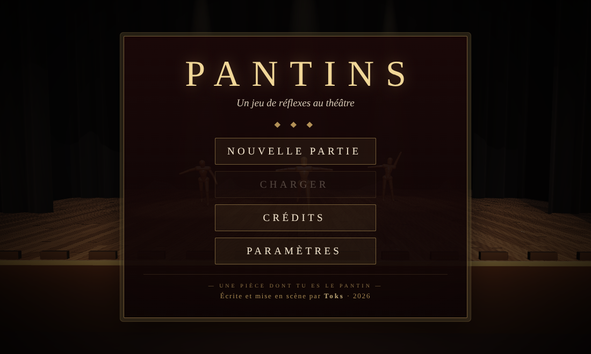

<div align="center">

# P A N T I N S

*Un jeu de réflexes au théâtre.*

**— Une pièce dont tu es le pantin —**



### [⬇ Télécharger Pantins pour Windows](https://github.com/Toka120/Pantins/releases/latest)

</div>

---

Le rideau se lève sur une scène vide. Des mannequins de bois surgissent dans la lumière des projecteurs. Vise, tire, survis.

Mais un théâtre a ses coulisses, ses dessous et ses secrets. Et quelqu'un, quelque part, tire les fils.

**Le reste se découvre sur scène.**

## Installer le jeu

1. Télécharge **Pantins-Windows.zip** sur la [page de téléchargement](https://github.com/Toka120/Pantins/releases/latest).
2. Dézippe le dossier où tu veux, par exemple dans *Documents* ou sur le *Bureau*.
3. Lance **Pantins.exe**.

Au premier lancement, Windows peut afficher « Windows a protégé votre ordinateur ». Le jeu n'a pas de signature payante d'éditeur, c'est normal : clique sur **Informations complémentaires**, puis sur **Exécuter quand même**.

## Le lanceur


`Pantins.exe` ouvre d'abord le lanceur.

- **Mises à jour automatiques.** À chaque démarrage, le lanceur regarde s'il existe une nouvelle version. Si oui, il la télécharge (environ 1,5 Mo) et vérifie que le fichier est intact avant de l'installer.
- **Sans internet**, tu joues à la dernière version déjà installée.
- **Notes de mise à jour.** Chaque version y est listée. Clique sur « Corrections de bugs » pour voir ce qui a été réparé. Le reste, à toi de le trouver.
- **Options.** Tu y règles les graphismes, le plein écran au démarrage et l'installation automatique. Le bouton *Réinstaller le jeu* sert en cas de problème.

Tes sauvegardes restent sur ton ordinateur et ne bougent pas pendant les mises à jour.

## Configuration

| | Minimum | Conseillé |
|---|---|---|
| Système | Windows 10, 64 bits | Windows 10 ou 11, 64 bits |
| Carte graphique | compatible WebGL 2 (la plupart des PC depuis 2015) | carte dédiée |
| Espace disque | 250 Mo | 250 Mo |
| Commandes | clavier et souris | clavier et souris |

Ton PC rame ? Dans **Paramètres → Graphismes**, choisis **Moyen** ou **Bas**. Coche **Afficher les IPS** pour voir le nombre d'images par seconde.

## Pour commencer

| Action | Touche |
|---|---|
| Se déplacer | Z Q S D (W A S D sur un clavier QWERTY) |
| Courir | Maj gauche |
| Viser | Souris |
| Tirer | Clic gauche |
| Passer une réplique | Entrée |
| Pause | Échap |

Les autres touches arrivent avec ce que tu découvres. Toutes peuvent être changées dans **Paramètres → Touches**.

## Questions

**Le jeu ne se lance pas ou affiche un écran noir.**
Mets à jour le pilote de ta carte graphique. Si ça ne suffit pas, ouvre *Options* dans le lanceur et clique sur *Réinstaller le jeu*.

**Je joue dans le navigateur. Mes sauvegardes passent-elles dans le lanceur ?**
Non. Le lanceur garde ses propres sauvegardes, à part de celles du navigateur.

**Comment quitter ?**
Dans le menu principal, clique sur *Quitter le jeu* pour revenir au lanceur. Tu peux aussi faire Alt + F4. F11 passe en plein écran ou en sort.

---

<details>
<summary>Pour le développement</summary>

Ce dépôt distribue les mises à jour au lanceur :

- `latest.json` : la dernière version, son empreinte SHA-256, sa taille et les notes de mise à jour (catégories `maps`, `armes`, `bugs` ; seuls les bugs sont détaillés) ;
- `game/pantins.html` : le jeu, en un seul fichier ;
- `lanceur/` : le code du lanceur (Electron). Pour fabriquer `Pantins.exe`, on place ce dossier dans `resources/app` d'une version Windows officielle d'Electron, avec une copie du jeu dans `lanceur/jeu/` (`pantins.html`, et `bundled.json`, une copie de `latest.json`) ;
- `outils/publier.py` : prépare une nouvelle version.

```
# nouvelle version du jeu
python outils/publier.py jeu chemin/vers/pantins.html 1.0.3 --cats bugs --bug "Description du bug corrigé."
# nouvelle version du lanceur (après avoir monté la version dans lanceur/package.json)
python outils/publier.py lanceur
git add -A && git commit -m "Pantins 1.0.3" && git push
```

Le lanceur se met lui-même à jour : `amorce.js` (livré avec `Pantins.exe`, jamais remplacé) charge la version la plus récente téléchargée dans `%APPDATA%\Pantins\lanceur`. Si une nouvelle version plante au démarrage, elle est mise de côté et l'amorce revient à la version livrée.

Les lanceurs installés récupèrent la version au démarrage suivant.

</details>

<div align="center">

*Écrite et mise en scène par **Toks** · 2026*

</div>
